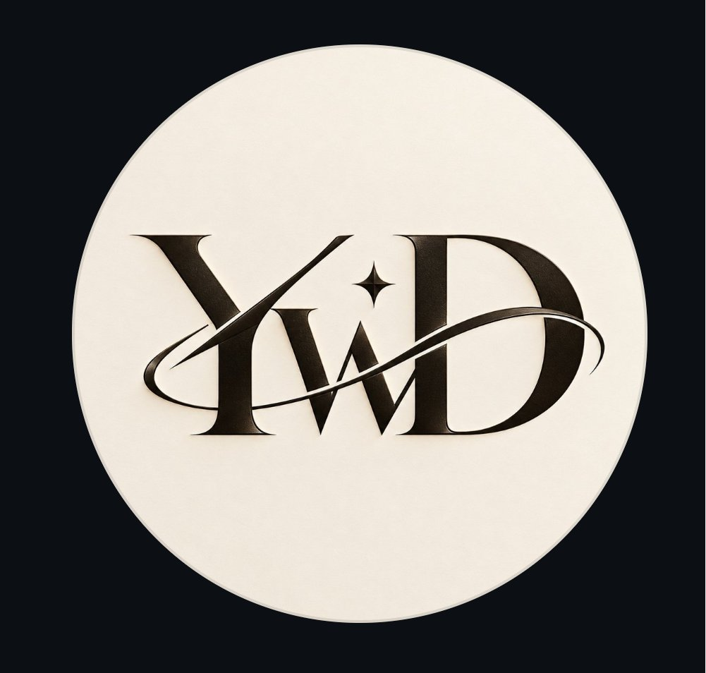

# YwD — Own Less. Experience More.

<p align="center">
  
</p>

<p align="center">
  <strong>College-First Equipment Rental & Verified Recommerce Marketplace</strong><br />
  <em>Cinematic product presentation backed by automated escrow protection, cryptographic dual-OTP handovers, and anonymous peer relay identity.</em>
</p>

<p align="center">
  
  
  
  
  
  
</p>

---

## 🏛️ Executive Summary

**YwD** is an institutional-grade digital marketplace engineered for campuses and modern creative communities. It makes high-value creative, compute, and academic hardware accessible without requiring full upfront purchases.

Whether borrowing a MacBook Pro M3 Max for a 48-hour hackathon, a Sony A7 IV cinema package for a campus film festival, or a Texas Instruments CAS graphing calculator for exam semester, YwD guarantees:

1. **100% Automated Escrow Protection:** Security deposits are isolated in a digital escrow vault and refunded automatically via UPI upon verified return.
2. **Cryptographic Dual-OTP Handover:** Handovers and returns require 6-digit cryptographic verification codes (`pickupOtp` / `returnOtp`) accompanied by 4-angle condition photo logs.
3. **Strict Counterparty Anonymity:** Students and equipment owners interact through anonymous system aliases (e.g., `EcoScholar-8421`, `LensCraft-3302`) with zero personal phone number exposure.
4. **Collision-Free Dynamic Loan Engine:** Precise availability scheduling across **Hourly**, **Daily**, **Weekly**, **Monthly**, and **Semester (90–120 days)** terms.

---

## 🎨 Visual Identity & Design Direction

YwD synthesizes luxury editorial craftsmanship, technical deconstruction, and cinematic commerce:

- **Corkwell-Inspired Cinematic Landing:** Full-viewport dark forest void (`#0E1F1A` to `#142921`), monumental editorial typography (*Own less. Experience more.*), floating master hardware pedestal, live duration rate calculations, and scroll-linked camera zoom kinematics.
- **Camber & Basalt Hardware Deconstruction:** Every listed product is framed as an engineered physical specimen with millimeter coordinate parchment, monospace archival numbering (`SPEC // MACBOOK • ELECTRONICS`), Basalt registration crosshairs (`+`), interactive dual-angle hover inspection, and tactile spec pills.
- **Talkroom Guided Discovery Studio:** A deterministic 5-step interactive questionnaire matching student project requirements (Discipline ➔ Scope ➔ Access Model ➔ Timeline ➔ Recommended Fleet).

### Brand Color Tokens

| Name | Hex | Usage |
| :--- | :--- | :--- |
| **Deep Forest** | `#18352D` | Primary brand color, dark cinematic void, primary buttons |
| **Burnt Orange** | `#C46A42` | Primary calls to action, active indicators, accent tags |
| **Warm Cream** | `#FAF7F2` / `#F5F0E8` | Parchment card canvases, editorial display backgrounds |
| **Soft Sage** | `#789681` | Escrow verification badges, status indicators, protocol tags |
| **Deep Charcoal** | `#202522` / `#0E1F1A` | Secondary dark banners, terminal containers |
| **White** | `#FFFFFF` | Elevated card surfaces, crisp text accents |

---

## 🛠️ Technology Stack & Architecture

- **Framework:** [Next.js 15](https://nextjs.org/) (App Router, Server Actions, Route Handlers).
- **Language:** [TypeScript](https://www.typescriptlang.org/) (Strict typing across domain models).
- **Styling:** [Tailwind CSS](https://tailwindcss.com/) with custom typography scale and hairline border tokens.
- **Motion & Kinematics:** [Framer Motion](https://www.framer.com/motion/) with scroll-linked camera kinematics and `prefers-reduced-motion` compliance.
- **Database & ORM:** [Prisma ORM](https://www.prisma.io/) with SQLite / PostgreSQL adapter and transparent dev store persistence.
- **Testing:** [Vitest](https://vitest.dev/) suite validating rental pricing math, escrow calculations, and privacy alias generation.

---

## 📂 Repository Structure

```
YwD/
├── prisma/
│   └── schema.prisma                 # Database schema definitions
├── public/
│   ├── images/
│   │   └── ywd-logo.png             # Official YwD circular monogram insignia
│   ├── videos/
│   │   ├── camber.mp4               # Blueprint specification study
│   │   ├── corkwell.mp4             # High-fashion editorial object study
│   │   └── basalt.mp4               # Carbon technical luxury study
│   └── favicon.ico                  # Browser favicon
├── src/
│   ├── app/
│   │   ├── api/                     # Backend API route handlers (products, bookings, orders)
│   │   ├── globals.css              # Global styling & KaTeX/Tailwind font rules
│   │   ├── layout.tsx               # Root layout with metadata & smooth scrolling
│   │   └── page.tsx                 # Master marketplace page
│   ├── components/
│   │   ├── auth/                    # Authentication modals with anonymous identity
│   │   ├── chat/                    # Privacy relay messaging drawer
│   │   ├── dashboard/               # Customer workspace (Rentals, Orders, Escrow)
│   │   ├── inspection/              # Dual-OTP & 4-angle proof verification modal
│   │   ├── layout/                  # Minimalist single-row Navbar & Footer
│   │   ├── marketplace/             # HeroSection, ProductCard, ProductGrid, SpecimenDeck
│   │   └── trust/                   # AccessProtocol & TrustSection guarantees
│   ├── data/
│   │   └── seedData.ts              # Curated hardware seed inventory
│   ├── lib/
│   │   ├── pricing.ts               # Tiered rental & escrow calculation math
│   │   └── privacy.ts               # Anonymous peer alias generator
│   └── __tests__/
│       └── marketplace.test.ts      # Unit tests (9/9 passing)
├── tailwind.config.ts               # YwD brand colors & typography tokens
├── tsconfig.json                    # TypeScript compiler options
└── package.json                     # NPM dependencies & scripts
```

---

## ⚡ Quick Start

### 1. Prerequisites
- Node.js 18.0.0 or higher
- npm or pnpm

### 2. Clone & Install
```bash
git clone https://github.com/Aaradhy1607/YwD.git
cd YwD
npm install
```

### 3. Environment Variables
Copy the environment template:
```bash
cp .env.example .env
```
*(Default settings work out-of-the-box for local development.)*

### 4. Database Setup
Generate Prisma client and run initial migration:
```bash
npx prisma generate
```

### 5. Start Development Server
```bash
npm run dev
```
Open [http://localhost:3000](http://localhost:3000) in your browser.

### 6. Run Test Suite
```bash
npm test
```
All unit test assertions for pricing calculations, duration tier scaling, and privacy alias generation will run through Vitest.

---

## 📜 Key Customer Journeys

1. **Discover:** Filter hardware by duration tier (`Hourly`, `Daily`, `Weekly`, `Monthly`, `Semester`) with instant collision-free availability.
2. **Reserve:** 100% refundable security deposit placed into isolated digital escrow.
3. **Inspect & Pickup:** Counterparties meet at a campus smart locker hub, conduct a 4-angle condition check, and authenticate the exchange with a 6-digit pickup OTP.
4. **Return & Refund:** Return OTP triggers automated escrow release, refunding 100% of the deposit directly to the renter's UPI account.

---

## 📄 License

This project is licensed under the MIT License — see the [LICENSE](LICENSE) file for details.
